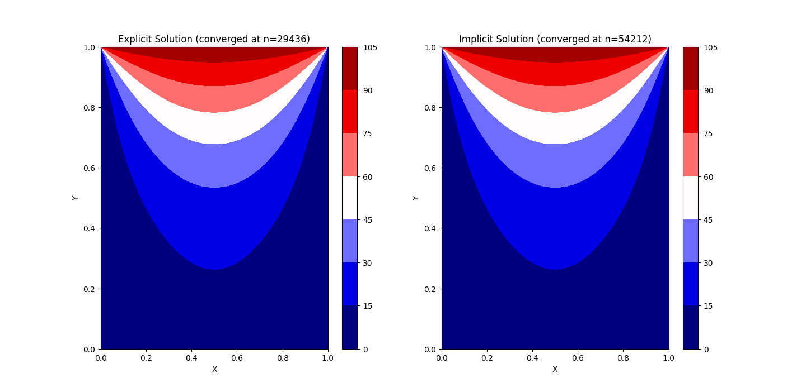

# Experiment 6: 2D Transient Heat Conduction

**Author:** Ayush Singh  
**Date:** October 11, 2026

## Aim
Analyze and compare explicit and implicit numerical solutions of 2D transient heat conduction on a square plate until convergence to steady-state.

## Assumptions & Limitations
The following physical and modeling assumptions are applied:
* **Unsteady Conduction:** Heat transfer within the solid domain is treated as transient (unsteady) conduction.
* **No Heat Generation:** Internal heat sources are neglected.
* **Uniform Properties:** Thermal diffusivity and conductivity are uniform and constant throughout the plate.
* **Square Domain Geometry:** The plate is square with equal lengths and uniform grid spacing ($L_x = L_y$, $\Delta x = \Delta y$).

## Governing Equations & Discretization
The governing 2D transient heat conduction equation without internal heat generation is:

$$ \frac{\partial T}{\partial t} = \alpha \left( \frac{\partial^2 T}{\partial x^2} + \frac{\partial^2 T}{\partial y^2} \right) $$

Using the Fourier number ($Fo = \frac{\alpha \Delta t}{\Delta x^2}$), the transient domain is discretized using finite difference methods for both explicit and implicit schemes:

**Explicit Scheme:**

$$ T_{i,j}^{n+1} = T_{i,j}^n + Fo \left( T_{i-1,j}^n + T_{i+1,j}^n + T_{i,j-1}^n + T_{i,j+1}^n - 4T_{i,j}^n \right) $$

**Implicit Scheme:**

$$ T_{i,j}^{n+1} = \frac{T_{i,j}^n + Fo \left( T_{i-1,j}^{n+1} + T_{i+1,j}^{n+1} + T_{i,j-1}^{n+1} + T_{i,j+1}^{n+1} \right)}{1 + 4Fo} $$

## Methodology and Boundary Conditions
The simulation evaluates a square plate domain discretized into $100 \times 100$ nodes with a Fourier number of $Fo = 0.25$. Iteration continues until the maximum absolute temperature change between consecutive steps drops below the convergence tolerance of $10^{-6}$.

The boundary conditions are explicitly enforced as:
* **Top Wall ($y = L$):** Dirichlet boundary condition fixed at $100^\circ\text{C}$ ($T[-1, :] = 100$).
* **Left Wall ($x = 0$):** Dirichlet boundary condition fixed at $0^\circ\text{C}$ ($T[:, 0] = 0$).
* **Right Wall ($x = L$):** Dirichlet boundary condition fixed at $0^\circ\text{C}$ ($T[:, -1] = 0$).
* **Bottom Wall ($y = 0$):** Insulated Neumann zero-gradient condition ($T[0, :] = T[1, :]$).

**Table 1: Parameter set and grid definition.**

| Parameter | Value | Parameter | Value |
| :--- | :--- | :--- | :--- |
| Plate Length ($L$) | $1.0$ | Grid Size ($nx \times nx$) | $100 \times 100$ |
| Fourier No. ($Fo$) | $0.25$ | Convergence Tolerance | $1.0\times 10^{-6}$ |

## Results & Discussions

**Temperature Distribution and Convergence:**
Figure 1 illustrates the steady-state temperature contour fields obtained from both the explicit and implicit solvers. Both methods accurately capture the thermal diffusion from the heated top boundary towards the insulated bottom boundary and cooled side walls. 

However, a significant difference in numerical efficiency is observed: the explicit solver converged in $29,436$ iterations, whereas the implicit solver required $54,212$ iterations to reach the same $10^{-6}$ residual threshold. While implicit schemes are unconditionally stable and allow for larger time steps in theory, evaluating point-by-point successive updates within a standard loop structure can substantially increase the iteration count required to satisfy strict steady-state convergence criteria compared to explicit updates at identical Fourier numbers.

  
*Figure 1: Steady-state temperature contours comparing explicit ($n=29436$) and implicit ($n=54212$) solutions.*

## Conclusion
Transient 2D heat conduction on a square plate was successfully modeled using explicit and implicit finite-difference formulations. The temperature distributions correctly reflect the applied Dirichlet and insulated boundary conditions. Although both schemes yield identical physical temperature profiles at convergence, the explicit solver demonstrated faster iteration-based convergence under the specified Fourier number constraint.