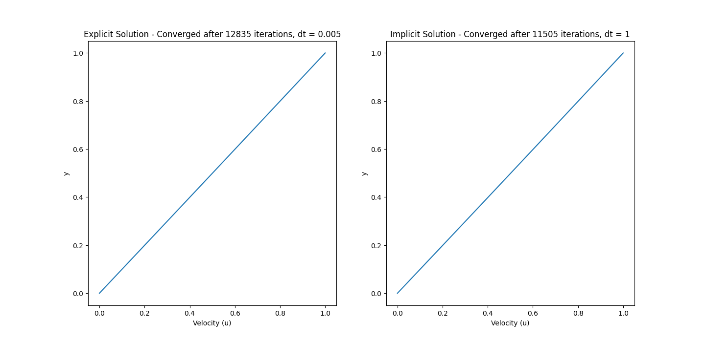
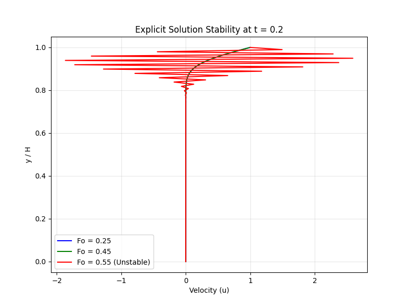

# Experiment 5: Transient Couette Flow

**Author:** Ayush Singh  
**Date:** October 11, 2026

## Aim
Compare explicit and implicit solutions of transient momentum diffusion in Couette flow by analyzing stability boundaries, computational effort, and numerical accuracy.

## Governing Equations & Simplification
The complete incompressible Navier-Stokes momentum equation in the $x$-direction is:

$$ \frac{\partial u}{\partial t} + u\frac{\partial u}{\partial x} + v\frac{\partial u}{\partial y} + w\frac{\partial u}{\partial z} = -\frac{1}{\rho}\frac{\partial p}{\partial x} + \nu\left(\frac{\partial^2 u}{\partial x^2} + \frac{\partial^2 u}{\partial y^2} + \frac{\partial^2 u}{\partial z^2}\right) $$

Based on the physical problem, the following assumptions are applied:
1. **Laminar, fully developed flow:** The transverse velocities are zero ($v = 0, w = 0$).
2. **No pressure gradient:** The flow is driven solely by the moving boundary ($\frac{\partial p}{\partial x} = 0$).
3. **1D flow variation:** Velocity only varies in the transverse direction ($\frac{\partial u}{\partial x} = 0, \frac{\partial^2 u}{\partial x^2} = 0, \frac{\partial^2 u}{\partial z^2} = 0$).
4. **Uniform properties:** Kinematic viscosity ($\nu$) and density ($\rho$) remain constant.

Applying these assumptions reduces the momentum equation to the 1D transient diffusion equation:

$$ \frac{\partial u}{\partial t} = \nu \frac{\partial^2 u}{\partial y^2} $$

To non-dimensionalize, we define $u^* = \frac{u}{U}$, $y^* = \frac{y}{H}$, and $t^* = \frac{t}{T}$. Substituting these yields:

$$ \frac{\partial u^*}{\partial t^*} = \left( \frac{1}{Re} \frac{TU}{H} \right) \frac{\partial^2 u^*}{\partial y^{*2}} $$

where the bracketed coefficient represents the non-dimensional momentum diffusivity.

## Methodology and Boundary Conditions
The equations are solved using a 1D Finite Volume Method (FVM) across a domain of height $H=1$ discretized into $100$ cells. Two temporal discretization schemes are compared: a forward-time explicit scheme and a backward-time implicit scheme. 

Letting $\Gamma = \frac{1}{Re} \frac{TU}{H}$ represent the non-dimensional momentum diffusivity, the discretized equations for node $j$ at time step $n$ are defined as:

**Explicit Scheme:**

$$ u_j^{n+1} = u_j^n + \Delta t \cdot \Gamma \left( \frac{u_{j+1}^n - 2u_j^n + u_{j-1}^n}{\Delta y^2} \right) $$

**Implicit Scheme:**

$$ u_j^{n+1} = \frac{ \frac{\Gamma}{\Delta y} \left( u_{j+1}^{n+1} + u_{j-1}^{n+1} \right) + \frac{\Delta y}{\Delta t} u_j^n }{ \frac{2\Gamma}{\Delta y} + \frac{\Delta y}{\Delta t} } $$

The Dirichlet boundary conditions are strictly enforced without separate ghost-cell treatment:
* **Stationary Bottom Wall ($y=0$):** $u = 0$.
* **Moving Top Wall ($y=H$):** $u = U = 1$.

**Table 1: Parameter set and grid definition.**

| Parameter | Value | Parameter | Value |
| :--- | :--- | :--- | :--- |
| Grid Resolution ($N_y$) | $100$ | Channel Height ($H$) | $1$ |
| Reynolds No. ($Re$) | $100$ | Top Wall Velocity ($U$) | $1$ |
| Time Scale ($T$) | $1$ | Convergence Tolerance | $1.0\times 10^{-6}$ |

## Results & Discussions

**Steady-State Convergence:**
Figure 1 demonstrates the final converged velocity profiles. Both the explicit and implicit schemes successfully arrive at the exact linear velocity profile indicative of steady Couette flow. However, the implicit scheme converged in $11505$ iterations using a massive time step ($dt = 1$), whereas the explicit scheme required $12835$ iterations constrained by a strict time step limit ($dt = 0.005$). This highlights how the implicit method allows for significantly reduced computational effort when marching to steady-state by utilizing large time steps.

  
*Figure 1: Steady-state convergence comparison between explicit and implicit solvers.*

**Transient Stability Boundary Analysis:**
A Fourier number ($Fo_{explicit} = \frac{\nu \Delta t}{\Delta y^2}$) parameteric study was conducted at $Fo = 0.25, 0.45, 0.55$. Figure 2 illustrates the velocity profiles at a fixed physical transient time. 

For 1D explicit diffusion, Von Neumann stability analysis dictates that the explicit scheme needs a strict stability criterion of $Fo \le 0.5$. The numerical results perfectly align with this physical interpretation. At $Fo = 0.25$ and $0.45$, the explicit solver yields smooth, bounded, and physically accurate velocity curves. However, at $Fo = 0.55$, the explicit scheme violates the stability boundary, resulting in unbounded, non-physical numerical oscillations that immediately crash the solver. 

In contrast, the implicit scheme is unconditionally stable. While it avoids crashing at high Fourier numbers, it does not mean that it will be more accurate; excessively large time steps in the implicit scheme introduce significant truncation errors that smear the transient accuracy. Furthermore, when running both schemes on the exact same parameters (identical time steps), the explicit method actually provides results faster, as it requires fewer matrix operations per iteration. The true advantage of the implicit scheme is that we can reduce the overall computational effort by intentionally taking bigger time steps without risking instability.

  
*Figure 2: Stability boundary analysis of the explicit scheme at varying Fourier numbers.*

## Conclusion
The transient momentum diffusion of Couette flow was successfully modeled. By simplifying the Navier-Stokes equations, both explicit and implicit FVM schemes were implemented. The explicit method was proven to be strictly bounded by the Von Neumann stability limit ($Fo \le 0.5$), failing catastrophically at $Fo = 0.55$. The implicit method circumvented this stability limit, demonstrating unconditional stability. While the explicit scheme is computationally faster per iteration, the implicit scheme drastically reduces the total computational effort required to reach steady-state by permitting much larger time steps.