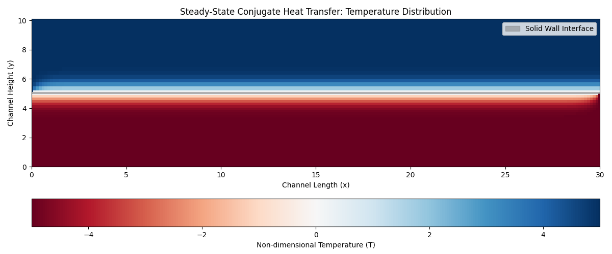
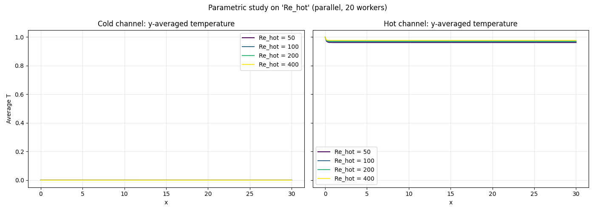
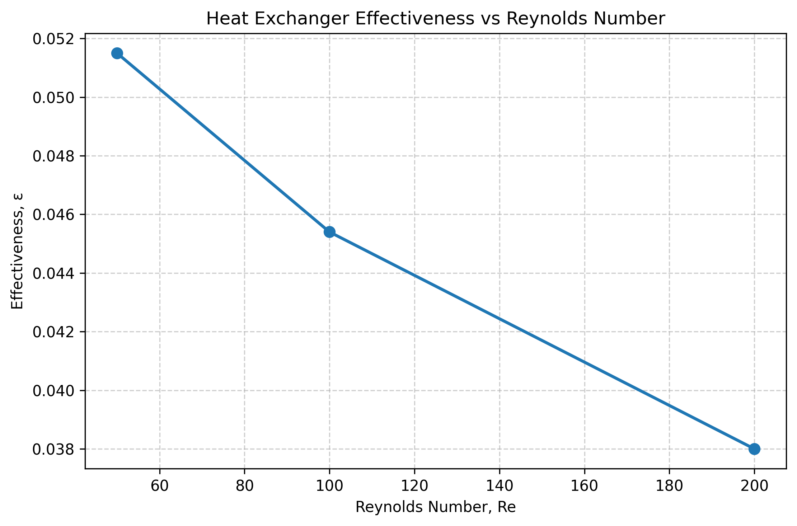
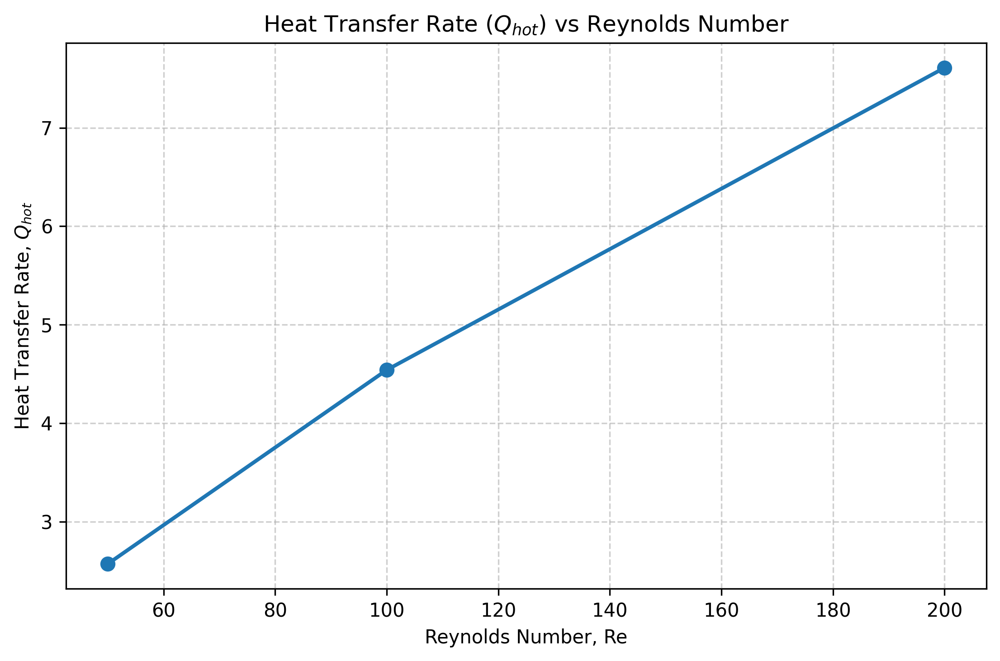
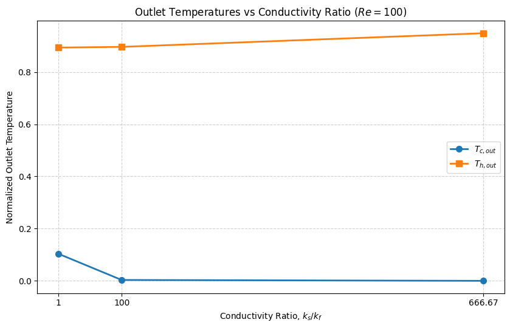

# Experiment 2: Conjugate Heat Transfer

**Author:** Ayush Singh  
**Date:** October 11, 2026

## Aim
Predict how heat moves from a hot stream to a cold stream across a solid wall, by solving one finite-difference field for the whole cross-section — both fluids and the wall — at the same time.

## Assumptions & Limitations
The following key assumptions and limitations apply to this supplied teaching model:
* **Planar Idealisation:** The pipe geometry is idealized as a 2D planar system rather than axisymmetric.
* **Prescribed Velocity:** The velocity field is predefined using a steady Poiseuille profile rather than dynamically solved via the Navier-Stokes equations.
* **Numerical Diffusion:** The implementation utilizes first-order-accurate upwinding for the convective terms, which introduces artificial numerical diffusion into the thermal field.

## Methodology and Domain
The simulation utilizes a single unified Cartesian grid of $200 \times 203$ nodes ($N_x \times N_y$), representing a length of $L_x = 30$ and an overall height comprised of three layers: cold fluid, solid wall, and hot fluid. 

The primary methodology solves a single unified finite-difference field mapping the entire cross-section. The governing physics transition naturally across the vertical domain as: **Convection+Conduction (cold stream)** $\rightarrow$ **Conduction (solid wall)** $\rightarrow$ **Convection+Conduction (hot stream)**. Because the velocity in the solid wall is prescribed identically as zero, the convective terms automatically cancel out in that region, leaving pure conduction. This eliminates the need to explicitly couple distinct domain meshes at the fluid-solid interfaces.

## Governing Equations & Discretization
The unified non-dimensional energy equation solved across the entire domain is:

$$ \frac{\partial T}{\partial t} + u \frac{\partial T}{\partial x} = D \left( \frac{\partial^2 T}{\partial x^2} + \frac{\partial^2 T}{\partial y^2} \right) $$

Where $D$ is a piecewise-constant field representing thermal diffusivity, defined locally for the cold fluid, the solid wall (incorporating the conductivity ratio $k_s/k_f$), and the hot fluid.

An explicit Finite Difference Method (FDM) scheme is utilized. Convection is discretized using first-order upwinding to maintain stability, while diffusion is handled with central differencing:

$$ T_P^{n+1} = T_P^n + \Delta t \left[ D_P \left(\frac{T_E - 2T_P + T_W}{\Delta x^2} + \frac{T_N - 2T_P + T_S}{\Delta y^2}\right) - u_P \frac{T_P - T_W}{\Delta x} \right] $$

## Methodology and Boundary Conditions
The simulation runs iteratively until the maximum absolute temperature change between steps falls below $0.5 \times 10^{-5}$. 

**Table 1: Complete parameter set and grid definition.**

| Parameter | Value | Parameter | Value |
| :--- | :--- | :--- | :--- |
| Grid ($N_x \times N_y$) | $200 \times 203$ | Length ($L_x$) | $30$ |
| Hot Channel ($Dy_{hot}$) | 5 | Cold Channel ($Dy_{cold}$) | 5 |
| Wall Thickness ($th$) | 0.1 | Conductivity Ratio ($k_s/k_f$) | 666.67 |
| Prandtl No. ($Pr$) | 7.0 | Convergence Tol. | $0.5\times 10^{-5}$ |

The boundary conditions strictly enforce a counter-flow heat exchanger setup:
* **Hot Inlet (Left, $x=0$):** Dirichlet $T = 1.0$.
* **Cold Inlet (Right, $x=L_x$):** Dirichlet $T = 0.0$ (counter-flow).
* **Outlets:** Zero-gradient Neumann conditions ($\partial T/\partial x = 0$).
* **Top & Bottom Boundaries:** Insulated zero-gradient conditions ($\partial T/\partial y = 0$).

## Results & Discussions

**Temperature Field and Conduction-Convection Physics:**
Figure 1 visually confirms the single-field approach. The sharp temperature gradients exist primarily in the boundary layers near the solid interface. The transition from convection and conduction in the fluids to pure conduction in the wall is handled seamlessly without explicit boundary matching.

  
*Figure 1: Steady-state conjugate heat transfer temperature distribution.*

**Parametric Velocity Effects:**
Figure 2 visualizes the $y$-averaged temperature profiles along the $x$-axis for varying hot-stream Reynolds numbers. Higher velocities push the thermal gradient further downstream before significant heat exchange occurs across the solid wall.

  
*Figure 2: Parametric study on varying Reynolds numbers showing averaged channel temperatures.*

**Quantitative Comparison (Reynolds Sweep):**
Table 2 and the subsequent figures detail the parametric sweep for $Re = 50, 100, 200$. As demonstrated in Figure 3, increasing the Reynolds number reduces the fluid residence time, which lowers the overall effectiveness of the heat exchanger. However, Figure 4 illustrates that despite the drop in effectiveness, the absolute heat transfer rate ($Q_{hot}$) strictly increases with mass flow rate. The energy imbalance remains consistently near $\sim 99.8\%$, reflecting the specific asymmetric thermal boundary accumulation in this 2D idealization.

**Table 2: Quantitative comparison of heat transfer metrics.**

| Re | $k_s/k_f$ | $T_{c, out}$ | $T_{h, out}$ | $Q_{hot}$ | Imbalance (%) | Effectiveness |
| :--- | :--- | :--- | :--- | :--- | :--- | :--- |
| 50 | 666.67 | 0.0001 | 0.9485 | 2.57 | 99.78 | 0.0515 |
| 100 | 666.67 | 0.0001 | 0.9546 | 4.54 | 99.80 | 0.0454 |
| 200 | 666.67 | 0.0001 | 0.9620 | 7.61 | 99.85 | 0.0380 |
| 100 | 1 | 0.1036 | 0.8936 | - | - | - |
| 100 | 100 | 0.0034 | 0.8962 | - | - | - |

  
*Figure 3: Effectiveness versus Reynolds Number.*

  
*Figure 4: Total Heat Transfer Rate ($Q_{hot}$) versus Reynolds Number.*

**Change in conductivity ratio:**
As illustrated in Figure 5, lowering the conductivity ratio to $1$ fundamentally shifts the system into a wall-resistance-dominated regime, allowing the cold stream outlet temperature to rise to $0.1036$. As the ratio increases ($\ge 100$), the system becomes convective-resistance-dominated.

  
*Figure 5: Outlet temperatures versus Conductivity Ratio at $Re=100$.*

## Conclusion
The conjugate heat transfer problem was successfully simulated by treating the combined fluid-solid-fluid domains as a single finite-difference field. While limited by planar assumptions and first-order upwinding, the model effectively demonstrated how varying Reynolds numbers and conductivity ratios dictate heat exchanger effectiveness, absolute heat transfer rates, and the transition between wall-dominated and convection-dominated thermal resistance.