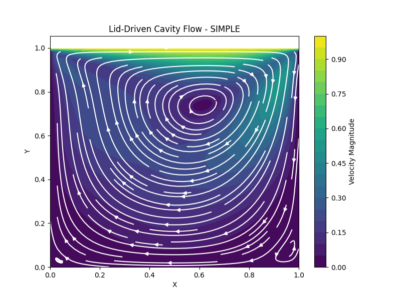
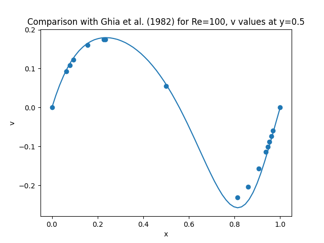

# Experiment 9: Lid-Driven Cavity Flow (SIMPLE)

**Author:** Ayush Singh  
**Date:** November 4, 2026

## Aim
Solve the 2D incompressible lid-driven cavity at $Re=100$ using the SIMPLE algorithm on a collocated grid, and validate the centreline velocity against the benchmark data of Ghia et al. (1982).

## Assumptions & Limitations
* **Incompressible, Laminar, 2D:** Constant density and viscosity; no turbulence model.
* **Pseudo-transient Marching:** The steady solution is reached by marching in time with $\Delta t=Co\,\Delta x/u_{lid}$ until the mass residual is below tolerance.
* **Collocated Grid:** $u$, $v$, $p$ are all stored at the same nodes, without Rhie–Chow interpolation.
* **Single Sweep for $p'$:** One Jacobi-type update of the pressure correction is made per SIMPLE iteration (the inner loop is commented out in the code).
* **Laminar Limit:** The solver cannot represent turbulence; the Ghia data for $Re=400,1000,10000$ are stored for flexibility, but only $Re=100$ is a valid laminar case here.

## Governing Equations & Simplification
For constant $\rho$ and $\nu$, the steady incompressible Navier–Stokes equations are

$$\nabla\cdot\mathbf{u}=0,\qquad (\mathbf{u}\cdot\nabla)\mathbf{u}=-\frac{1}{\rho}\nabla p+\nu\nabla^2\mathbf{u}$$

In 2D components:

$$\frac{\partial u}{\partial t}+u\frac{\partial u}{\partial x}+v\frac{\partial u}{\partial y} = -\frac{1}{\rho}\frac{\partial p}{\partial x}+\nu\left(\frac{\partial^2u}{\partial x^2}+\frac{\partial^2u}{\partial y^2}\right)$$

$$\frac{\partial v}{\partial t}+u\frac{\partial v}{\partial x}+v\frac{\partial v}{\partial y} = -\frac{1}{\rho}\frac{\partial p}{\partial y}+\nu\left(\frac{\partial^2v}{\partial x^2}+\frac{\partial^2v}{\partial y^2}\right)$$

The time derivative is kept only as a *relaxation device* (pseudo-time) towards steady state. The Reynolds number fixes the viscosity:

$$Re=\frac{U_{lid}L}{\nu}=100\;\Rightarrow\;\nu=\frac{U_{lid}L}{Re}=0.01$$

## Discretization & Algorithm
### Finite-Volume Momentum Equations
Integrating over a control volume with implicit Euler time stepping:

$$a_P\phi^*_P=\sum a_{nb}\phi^*_{nb}+a_P^0\phi^n_P+\text{(pressure term)},\qquad a_P=\sum a_{nb}+a_P^0,\quad a_P^0=\frac{\rho\Delta x\Delta y}{\Delta t}$$

with face flux $F_f=\rho u_f A_f$, diffusion conductance $D_f=\nu A_f/\Delta$ and cell Péclet number $\mathrm{Pe}_f=F_f/D_f$. Neighbour coefficients follow the **Power-Law scheme**:

$$a_E=D_eA(|\mathrm{Pe}_e|)+\max(-F_e,0),\quad a_W=D_wA(|\mathrm{Pe}_w|)+\max(F_w,0),\quad A(\mathrm{Pe})=\max[0,(1-0.1|\mathrm{Pe}|)^5]$$

($a_N,a_S$ analogous). Face velocities are the arithmetic means of adjacent nodes, and the pressure gradient is a central difference over two cells, $(p_W-p_E)\Delta y/2$ and $(p_S-p_N)\Delta x/2$.

### Pressure Correction
With $u=u^*+u'$, $p=p^*+p'$ and the SIMPLE approximation (neighbour corrections neglected):

$$u'_P=d_e\frac{p'_W-p'_E}{2},\quad v'_P=d_n\frac{p'_S-p'_N}{2},\qquad d_e=\frac{\Delta y}{a_P},\ d_n=\frac{\Delta x}{a_P}$$

Substituting into continuity gives

$$a'_Pp'_P=a'_Ep'_E+a'_Wp'_W+a'_Np'_N+a'_Sp'_S+b,\quad b=\rho\frac{u^*_W-u^*_E}{2}\Delta y+\rho\frac{v^*_S-v^*_N}{2}\Delta x$$

where $b$ is the mass imbalance of the guessed field and is also used as the convergence monitor, $\max|b|<10^{-6}$.

### Update and Under-relaxation

$$p=p^*+\alpha_pp',\qquad u=u^*+u',\quad v=v^*+v',\qquad \alpha_p=0.3$$

Pressure under-relaxation prevents divergence caused by the SIMPLE neglect of neighbour corrections.

### Algorithm
1. Initialize $u=v=p=0$ with the lid velocity $u=U_{lid}$ on the top row.
2. Solve the momentum equations for $u^*,v^*$ using the current $p^*$; enforce wall BCs.
3. Solve the pressure-correction equation; update $p$ (relaxed) with zero-gradient walls.
4. Correct velocities; re-apply BCs.
5. Check $\max|b|<10^{-6}$; otherwise repeat (up to $n_t=20000$ iterations).

## Code Structure
* `all u, v, p stored on the same (ny, nx) mesh` – collocated arrangement.
* `Power Law Scheme` – function `A(P)` for convection–diffusion weighting.
* `u_old, v_old: previous time level | u, v, p: current guess` – $\phi^n$ for the transient term; $\phi^*$ for the SIMPLE iterate.
* `faces (uniform grid)` – face values by simple averaging.
* `/2: central difference over 2 cells` – pressure-gradient and mass-flux terms span $i-1$ to $i+1$.
* `internal loop for time relaxation` (commented out) – a single sweep of the $p'$ equation is done per iteration; inner sweeps could be enabled for a tighter $p'$ solution.
* `zero gradient at walls` – Neumann condition for $p$ and $p'$.
* `p = p* + alpha_p p'` and `u = u* + u', v = v* + v'` – the SIMPLE update step.
* `Validation with Ghia et al.` – tabulated $v$ at $y=0.5$ for $Re=100,400,1000,10000$ at the Ghia abscissae `x_test`; only the $Re=100$ set is plotted.

## Methodology and Boundary Conditions
**Table 1: Parameter set for the lid-driven cavity.**

| Parameter | Value | Parameter | Value |
| :--- | :--- | :--- | :--- |
| Cavity size ($L_x=L_y$) | $1.0$ | Grid ($n_x\times n_y$) | $60\times60$ |
| Lid velocity $U_{lid}$ | $1.0$ | Density $\rho$ | $1.0$ |
| Reynolds number | $100$ | Kinematic viscosity $\nu$ | $0.01$ |
| Courant number $Co$ | $0.5$ | Time step $\Delta t=Co\,\Delta x/U_{lid}$ | $\approx8.5\times10^{-3}$ |
| Pressure relaxation $\alpha_p$ | $0.3$ | Tolerance | $1.0\times10^{-6}$ |

* **Top wall (lid):** $u=U_{lid}=1$, $v=0$.
* **Left, right and bottom walls:** no-slip, $u=v=0$.
* **Pressure and $p'$:** zero normal gradient on all walls (pressure level is arbitrary in a closed cavity).

## Results & Discussions
Figure 1 shows the velocity-magnitude contours and streamlines. The lid drives a primary vortex whose centre lies slightly above the cavity centre and shifted towards the lid-moving side, as expected at $Re=100$, with the strongest velocities near the lid.

  
*Figure 1: Velocity magnitude and streamlines for the $Re=100$ lid-driven cavity.*

**Validation:** Figure 2 compares the computed $v$-velocity along $y=0.5$ with the benchmark of Ghia et al. The numerical curve passes almost exactly through the benchmark points, validating the SIMPLE implementation, the Power-Law discretization and the boundary treatment.

  
*Figure 2: Comparison of $v(x)$ at $y=0.5$ with Ghia et al. (1982) at $Re=100$.*

**Higher Reynolds numbers:** The code carries benchmark data for $Re=400$, $1000$ and $10000$, and $Re$ can be changed freely. However, the very high-$Re$ flows are unsteady/turbulent, and a laminar steady-state model is not valid there; a turbulence closure (as in Experiment 10) would be needed.

## Conclusion
The SIMPLE algorithm on a collocated grid with Power-Law convection–diffusion discretization and pressure under-relaxation reproduces the benchmark lid-driven cavity solution at $Re=100$. The method is validated against Ghia et al., and its limits (laminar regime, no Rhie–Chow correction, single $p'$ sweep) are identified for future extensions.