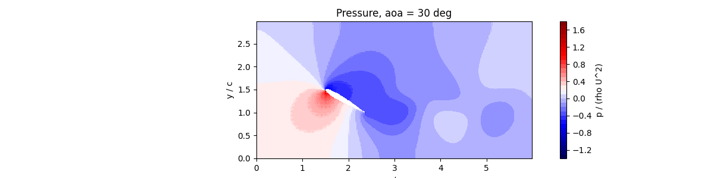
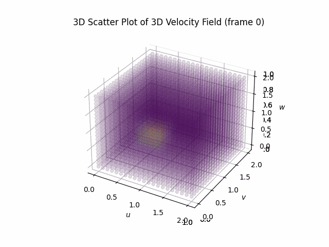

<div align="center">

# Computational Fluid Dynamics — Numerical Experiments

**CFD Course · 7th Semester, Mechanical Engineering Department**  
**Pandit Deendayal Energy University (PDEU), Gandhinagar**  
*Under the guidance of Dr. Anirudh Kulkarni*

</div>

---

This repository brings together eleven computational experiments completed as part of the **Computational Fluid Dynamics (CFD) course**. The work focuses on translating governing equations into numerical methods, implementing the solvers, and interpreting the resulting flow and thermal fields.

The implementations were developed primarily independently, with governing equations and discretizations worked through by hand before coding. **AI assistance was minimal**; the emphasis throughout was on understanding the underlying physics, numerical formulation, implementation, and verification.

## Experiments at a glance

<table>
  <tr>
    <td width="50%" valign="top">

### 1. 2D Transient Heat Conduction

<a href="2D%20conduction/README.md"></a>

Compare explicit and implicit finite-difference schemes on a square plate, including transient evolution and convergence to steady state.

**Key methods:** Finite Difference Method (FDM), explicit and implicit time integration.

[Open experiment README →](<2D conduction/README.md>)

</td>
    <td width="50%" valign="top">

### 2. Airfoil Flow — Immersed Boundary Method

<a href="airfoil/README.md"></a>

Investigate how angle of attack affects the velocity field, wake development, pressure distribution, and lift and drag trends around a NACA 0012 airfoil.

**Key methods:** Incompressible Navier–Stokes equations, volume penalization, fractional-step projection.

[Open experiment README →](<airfoil/README.md>)

</td>
  </tr>
  <tr>
    <td width="50%" valign="top">

### 3. Centrifugal Pump

<a href="centrifugal%20pump/README.md"></a>

Model a simplified rotating annular passage to examine temperature distribution, radial pressure rise, velocity components, and pump-head scaling with rotational speed.

**Key methods:** Polar-coordinate governing equations, FDM, Jacobi iteration, grid-refinement checks.

[Open experiment README →](<centrifugal pump/README.md>)

</td>
    <td width="50%" valign="top">

### 4. Transient Couette Flow

<a href="Couette%20flow/README.md"></a>

Compare explicit and implicit numerical solutions for momentum diffusion between a stationary wall and a moving wall, with emphasis on stability and computational effort.

**Key methods:** Finite Volume Method (FVM), diffusion discretization, Fourier-number stability analysis.

[Open experiment README →](<Couette flow/README.md>)

</td>
  </tr>
  <tr>
    <td width="50%" valign="top">

### 5. Conjugate Heat Transfer

<a href="Heat%20exchanger/README.md"></a>

Solve heat transfer across a cold stream, a solid wall, and a hot stream using a unified temperature field, then examine the effects of Reynolds number and conductivity ratio.

**Key methods:** FDM, convection–diffusion, fluid–solid thermal coupling.

[Open experiment README →](<Heat exchanger/README.md>)

</td>
    <td width="50%" valign="top">

### 6. Von Kármán Vortex Street

<a href="right%20cylinder/README.md"></a>

Simulate unsteady flow past a circular cylinder and study alternating vortex shedding, lift oscillations, and the Strouhal number at \(Re = 100\).

**Key methods:** Incompressible Navier–Stokes equations, immersed boundary method, transient flow analysis, FFT.

[Open experiment README →](<right cylinder/README.md>)

</td>
  </tr>
  <tr>
    <td width="50%" valign="top">

### 7. 1D Shallow Water Wave Propagation

<a href="shallow%20water/README.md"></a>

Propagate a surface hump governed by the linear shallow water equations and compare explicit and implicit upwind solutions with the exact analytical result, including numerical diffusion effects.

**Key methods:** Characteristic variables, FVM first-order upwind, explicit and implicit schemes, Jacobi iteration, modified-equation analysis.

[Open experiment README →](<shallow water/README.md>)

</td>
    <td width="50%" valign="top">

### 8. Rayleigh–Taylor Instability

<a href="Rayleigh%20Taylor/README.md"></a>

Simulate a heavy fluid above a light fluid and follow the growth of a single-mode interface perturbation under buoyancy using a two-fluid incompressible solver.

**Key methods:** SIMPLE pressure–velocity coupling, Power-Law scheme, Volume of Fluid (VOF), adaptive time step.

[Open experiment README →](<Rayleigh Taylor/README.md>)

</td>
  </tr>
  <tr>
    <td width="50%" valign="top">

### 9. Lid-Driven Cavity Flow

<a href="lid%20driven%20cavity/README.md"></a>

Solve the classical lid-driven cavity at \(Re = 100\) on a collocated grid and validate the centreline velocity against the benchmark data of Ghia et al. (1982).

**Key methods:** SIMPLE algorithm, collocated grid, Power-Law scheme, pressure under-relaxation, benchmark validation.

[Open experiment README →](<lid driven cavity/README.md>)

</td>
    <td width="50%" valign="top">

### 10. Turbulent Pipe Flow

<a href="turbulent%20pipe/README.md"></a>

Compute the mean velocity profile of fully developed turbulent pipe flow with algebraic eddy-viscosity models and compare with the law of the wall and the Blasius friction factor.

**Key methods:** RANS (Boussinesq), Prandtl and van Driest mixing length, FVM on concentric rings, Picard iteration.

[Open experiment README →](<turbulent pipe/README.md>)

</td>
  </tr>
  <tr>
    <td width="50%" valign="top">

### 11. 3D Convection–Diffusion

<a href="3D%20convection%20diffusion/README.md"></a>

Solve the coupled 3D viscous Burgers equations on a cubic domain and observe how an initial high-velocity cube diffuses and convects towards the ambient state.

**Key methods:** FDM, explicit time marching, convection–diffusion, diffusion-based stability limit.

[Open experiment README →](<3D convection diffusion/README.md>)

</td>
    <td width="50%" valign="top"></td>
  </tr>
</table>

---

## Numerical methods and concepts

Across the experiments, the work explores:

- **Discretization:** finite difference and finite volume methods, including first-order upwind and the Power-Law scheme.
- **Time integration:** explicit and implicit schemes, including their stability, numerical diffusion and convergence behaviour.
- **Flow solvers:** SIMPLE pressure correction, fractional-step projection, continuity enforcement, and immersed-boundary volume penalization.
- **Multiphase flow:** Volume of Fluid (VOF) interface advection for two-fluid problems.
- **Turbulence modelling:** algebraic (zero-equation) RANS closures, namely Prandtl and van Driest mixing length.
- **Wave propagation:** characteristic-variable decoupling of hyperbolic equations.
- **Heat transfer:** transient conduction, convection–diffusion, and conjugate heat transfer.
- **Verification and analysis:** residual monitoring, grid refinement, parameter sweeps, benchmark validation (Ghia et al.), analytical comparison, and comparison with expected physical behaviour.
- **Post-processing:** temperature, pressure, velocity and vorticity fields, along with lift, drag, pump head, friction factor, and heat-transfer metrics.

## Repository structure

Each experiment is maintained in its own folder with its implementation, result figures, and a dedicated README containing the aim, assumptions, governing equations, numerical methodology, results, and conclusion.

```text
.
├── 2D conduction/
├── airfoil/
├── centrifugal pump/
├── Couette flow/
├── Heat exchanger/
├── right cylinder/
├── shallow water/
├── Rayleigh Taylor/
├── lid driven cavity/
├── turbulent pipe/
├── 3D convection diffusion/
├── LICENSE
└── README.md
```

*Folder and image names in this overview are relative paths. If you rename a folder or figure, update the corresponding links above.*

## Note

These are educational numerical models. Their assumptions and limitations are documented in the individual experiment READMEs; results should be interpreted within those modelling choices.

---

<div align="center">

**Ayush Singh** · Mechanical Engineering · PDEU

</div>