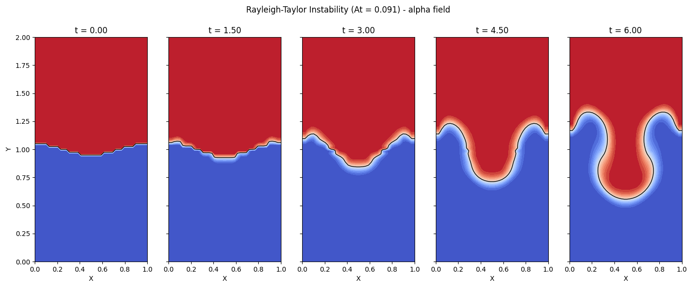
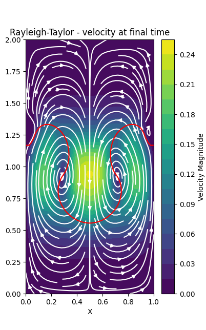

# Experiment 8: Rayleigh–Taylor Instability (SIMPLE + VOF)

**Author:** Ayush Singh  
**Date:** November 4, 2026

## Aim
Simulate the Rayleigh–Taylor instability of a heavy fluid resting above a light fluid using a pressure-based SIMPLE solver coupled with a Volume-of-Fluid (VOF) transport equation, and observe the interface evolution from $t=0$ to $t=6$ s.

## Assumptions & Limitations
* **2D, Laminar, Unsteady:** Flow is two-dimensional, laminar and time-accurate; no turbulence model is used.
* **Two Incompressible, Immiscible Fluids:** Each fluid is incompressible ($\nabla\cdot\mathbf{u}=0$) with constant density; density varies only through the volume fraction $\alpha$.
* **Constant Viscosity:** A single dynamic viscosity $\mu$ is used for the mixture; no surface tension.
* **Boussinesq-type Buoyancy:** Gravity acts in $-y$ and only the density difference from a reference density, $(\rho-\rho_{ref})g$, is retained as body force (the hydrostatic part is absorbed in the pressure).
* **First-order VOF:** The interface is advected by a bounded first-order upwind scheme, hence it is numerically diffused (no geometric reconstruction/PLIC).
* **Collocated Grid:** $u$, $v$, $p$, $\alpha$ share one $(n_y\times n_x)$ mesh; no Rhie–Chow interpolation is used.

## Governing Equations & Simplification
**Volume fraction and mixture density.** $\alpha=1$ denotes the heavy fluid (top) and $\alpha=0$ the light fluid:

$$\rho = \rho_l + (\rho_h-\rho_l)\,\alpha, \qquad At=\frac{\rho_h-\rho_l}{\rho_h+\rho_l}$$

**Continuity and momentum** (variable density, constant $\mu$):

$$\nabla\cdot\mathbf{u}=0, \qquad \frac{\partial(\rho\mathbf{u})}{\partial t}+\nabla\cdot(\rho\mathbf{u}\mathbf{u}) = -\nabla p + \mu\nabla^2\mathbf{u} - (\rho-\rho_{ref})\,g\,\hat{\mathbf{j}}$$

with $\rho_{ref}=\tfrac12(\rho_l+\rho_h)$. Subtracting $\rho_{ref}g$ simply redefines $p$ (removes the hydrostatic mean), so the only body force left is the *net* buoyancy that drives the instability. In components:

$$\frac{\partial(\rho u)}{\partial t}+\frac{\partial(\rho u u)}{\partial x}+\frac{\partial(\rho v u)}{\partial y} = -\frac{\partial p}{\partial x}+\mu\nabla^2 u$$

$$\frac{\partial(\rho v)}{\partial t}+\frac{\partial(\rho u v)}{\partial x}+\frac{\partial(\rho v v)}{\partial y} = -\frac{\partial p}{\partial y}+\mu\nabla^2 v-(\rho-\rho_{ref})g$$

**VOF transport.** Because $\nabla\cdot\mathbf{u}=0$, the conservative and advective forms coincide:

$$\frac{\partial\alpha}{\partial t}+\nabla\cdot(\mathbf{u}\alpha)=\frac{\partial\alpha}{\partial t}+u\frac{\partial\alpha}{\partial x}+v\frac{\partial\alpha}{\partial y}=0$$

**Reference (linear theory).** For a small single-mode perturbation of wavelength $\lambda=L_x$ the inviscid growth rate is $\sigma=\sqrt{At\,g\,k}$ with $k=2\pi/\lambda$; the small Atwood number ($At\approx0.091$) makes the growth slow and the roll-up gradual.

## Discretization & Algorithm
### Finite-Volume Momentum Equation
Integrating over a control volume $\Delta x\Delta y$ with implicit (backward) Euler in time gives, for each component,

$$a_P\,\phi^*_P = a_E\phi^*_E+a_W\phi^*_W+a_N\phi^*_N+a_S\phi^*_S + b_\phi + \text{(pressure term)}, \qquad a_P=\sum a_{nb}+a_P^0$$

where $a_P^0=\rho_P\Delta x\Delta y/\Delta t$. Face fluxes and diffusion conductances are

$$F_f=(\rho u)_f A_f,\qquad D_f=\frac{\mu A_f}{\Delta},\qquad \mathrm{Pe}_f=\frac{F_f}{D_f}$$

and the neighbour coefficients use the **Power-Law scheme** (Patankar):

$$a_E = D_e\,A(|\mathrm{Pe}_e|)+\max(-F_e,0), \qquad a_W = D_w\,A(|\mathrm{Pe}_w|)+\max(F_w,0)$$

$$A(\mathrm{Pe}) = \max\left[0,\,(1-0.1|\mathrm{Pe}|)^5\right]$$

(and similarly for $a_N,a_S$). Face values of $u$, $v$, $\rho$ are linear averages of the two adjacent nodes (uniform grid). The source terms are

$$b_u=a_P^0u^{n},\qquad b_v=a_P^0v^{n}-(\rho_P-\rho_{ref})\,g\,\Delta x\Delta y$$

and the pressure gradient is a central difference over two cells:

$$u^*_P\ni\frac{p_W-p_E}{2}\frac{\Delta y}{a_P},\qquad v^*_P\ni\frac{p_S-p_N}{2}\frac{\Delta x}{a_P}$$

### Pressure Correction (SIMPLE)
Writing $u=u^*+u'$, $p=p^*+p'$ and neglecting neighbour-velocity corrections (the SIMPLE approximation):

$$u'_P=d_e\,\frac{p'_W-p'_E}{2},\quad v'_P=d_n\,\frac{p'_S-p'_N}{2},\qquad d_e=\frac{\Delta y}{a_P},\; d_n=\frac{\Delta x}{a_P}$$

Imposing continuity gives the pressure-correction equation

$$a'_P p'_P = a'_Ep'_E+a'_Wp'_W+a'_Np'_N+a'_Sp'_S + b, \qquad a'_E=\rho_P d_e\Delta y,\; a'_N=\rho_P d_n\Delta x$$

$$b=\rho_P\frac{u^*_W-u^*_E}{2}\Delta y+\rho_P\frac{v^*_S-v^*_N}{2}\Delta x \quad(\text{mass imbalance})$$

$p'$ is solved with 50 Jacobi sweeps and zero-gradient walls. The residual reported is $\max|b|$.

### Under-relaxation and Correction
Pressure is under-relaxed, $p=p^*+\alpha_p p'$ with $\alpha_p=0.3$, while velocities are corrected with the full $p'$. The implicit transient term $a_P^0$ itself acts as inertial relaxation on the velocities.

### VOF Update
The advection of $\alpha$ is explicit and first-order upwind (bounded):

$$\alpha^{n+1}_P=\alpha^n_P-\Delta t\left(u_P\left.\frac{\partial\alpha}{\partial x}\right|_{up}+v_P\left.\frac{\partial\alpha}{\partial y}\right|_{up}\right),\qquad \alpha\in[0,1]\ \text{(clipped)}$$

followed by the density update $\rho=\rho_l+(\rho_h-\rho_l)\alpha$.

### Adaptive Time Step
Since $\mathbf{u}=0$ at $t=0$, a convective limit alone gives $\Delta t\to\infty$, so a three-way minimum is used:

$$\Delta t=\min\left[\frac{CFL_{max}}{|u|_{max}/\Delta x+|v|_{max}/\Delta y},\;\frac{0.45}{2\nu_{max}(1/\Delta x^2+1/\Delta y^2)},\;0.01\right],\quad \nu_{max}=\frac{\mu}{\rho_l}$$

with $CFL_{max}=0.3$. The viscous bound uses the *light* fluid because it has the largest kinematic viscosity.

### Solution Procedure per Time Step
1. Compute $\Delta t$; store $\mathbf{u}^n$, $\alpha^n$.
2. Repeat $n_{inner}=3$ times: solve $u^*,v^*$ → apply wall BCs → solve $p'$ → update $p$ → correct $u,v$ → apply BCs.
3. Advect $\alpha$ with the corrected velocity and update $\rho$.
4. Advance $t$; store snapshots at $t=0,1.5,3,4.5,6$ s.

## Methodology and Boundary Conditions
**Table 1: Simulation parameters (non-dimensional units).**

| Parameter | Value | Parameter | Value |
| :--- | :--- | :--- | :--- |
| Domain ($L_x\times L_y$) | $1\times2$ | Grid ($n_x\times n_y$) | $40\times80$ |
| Light density $\rho_l$ | $1.0$ | Heavy density $\rho_h$ | $1.2$ |
| Atwood number $At$ | $0.091$ | Gravity $g$ | $1.0$ |
| Viscosity $\mu$ | $2\times10^{-3}$ | Inner SIMPLE iterations | $3$ |
| Pressure relaxation $\alpha_p$ | $0.3$ | End time $t_{end}$ | $6 \text{ s}$ |
| $CFL_{max}$ | $0.3$ | $\Delta t_{max}$ | $0.01$ |

**Initial condition:** fluid at rest, with a single-mode interface $y_{int}=\tfrac{L_y}{2}+0.05L_x\cos(2\pi x/L_x)$ and the heavy fluid above it ($\alpha=1$ for $y>y_{int}$).

**Boundary conditions:**
* **All four walls:** no-slip, $u=v=0$.
* **Pressure, pressure correction and $\alpha$:** zero normal gradient on all walls.

## Results & Discussions
Figure 1 shows the $\alpha$ field at $t=0,\,1.5,\,3,\,4.5$ and $6$ s. The initial cosine perturbation grows under buoyancy: heavy fluid sinks as a spike/bubble pair, and the interface progressively distorts, as expected for the Rayleigh–Taylor instability at low Atwood number. The interface is slightly diffuse due to the first-order upwind VOF scheme.

  
*Figure 1: Volume-fraction ($\alpha$) field at $t=0,1.5,3.0,4.5,6.0$ s with the $\alpha=0.5$ interface contour.*

Figure 2 shows the streamlines at the final time. The flow organizes into counter-rotating recirculation cells on either side of the descending heavy-fluid spike and rising light-fluid bubble, with the highest velocity magnitudes near the interface where the density jump drives the motion.

  
*Figure 2: Velocity magnitude and streamlines at the final time with the interface in red.*

## Conclusion
A SIMPLE-based collocated solver with Power-Law convection–diffusion discretization was coupled with an explicit bounded VOF advection to capture the Rayleigh–Taylor instability. The adaptive time step (convective, viscous and capped limits) handled the zero-velocity start, and the interface evolution is physically consistent. Future improvements include Rhie–Chow interpolation, higher-order or geometric (PLIC) interface advection, and a finer grid to sharpen the interface.