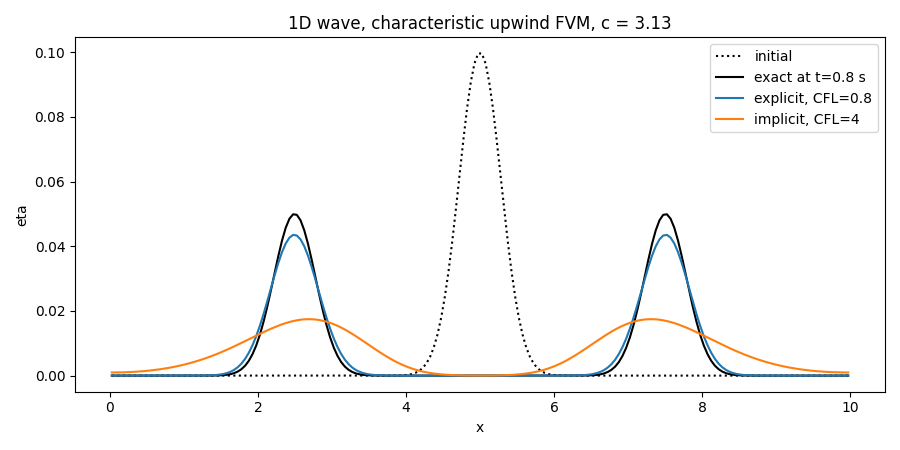

# Experiment 7: 1D Linear Shallow Water Wave Propagation

**Author:** Ayush Singh  
**Date:** November 4, 2026

## Aim
Simulate the propagation of a surface hump in the 1D linear shallow water equations using a finite-volume, first-order upwind scheme on the characteristic variables, and compare explicit and implicit time integration with the exact analytical solution.

## Assumptions & Limitations
* **Linear Shallow Water:** The surface elevation $\eta$ is small compared with the mean depth $H$, so convective terms are neglected and the equations are linear.
* **Constant Depth:** $H$ is uniform, hence the wave speed $c=\sqrt{gH}$ is constant and non-dispersive.
* **Inviscid, Frictionless, 1D:** No viscosity, bed friction or variation across the channel.
* **First-order Upwind:** The scheme is bounded and free of wiggles, but introduces numerical diffusion that smears the pulse.
* **Reflecting Walls:** Both ends are solid walls; the run ends before the pulses reach them.

## Governing Equations & Simplification
The linearized 1D shallow water (mass and momentum) equations are

$$\frac{\partial\eta}{\partial t}+H\frac{\partial u}{\partial x}=0,\qquad \frac{\partial u}{\partial t}+g\frac{\partial\eta}{\partial x}=0,\qquad c=\sqrt{gH}$$

**Decoupling via characteristics.** Multiplying the momentum equation by $H/c$ and using $gH/c=c$ gives $\frac{H}{c}u_t+c\,\eta_x=0$. Adding and subtracting it from the mass equation (written as $\eta_t+c\,\tfrac{H}{c}u_x=0$) yields two independent advection equations for

$$r=\eta+\frac{H}{c}u,\qquad l=\eta-\frac{H}{c}u$$

$$\frac{\partial r}{\partial t}+c\frac{\partial r}{\partial x}=0\ \ (\text{right-moving}),\qquad \frac{\partial l}{\partial t}-c\frac{\partial l}{\partial x}=0\ \ (\text{left-moving})$$

The physical variables are recovered from

$$\eta=\frac{r+l}{2},\qquad u=\frac{c}{2H}(r-l)$$

This turns a coupled $2\times2$ system into two scalar advection equations, so the upwind direction is known without any matrix splitting.

**Initial condition.** A Gaussian hump at rest ($u=0$), so $r=l=\eta_0$:

$$\eta_0(x)=A\exp\left[-\left(\frac{x-x_0}{w}\right)^2\right]$$

**Exact solution (d'Alembert).** The hump splits into two half-amplitude pulses travelling in opposite directions:

$$\eta(x,t)=\frac{A}{2}\left\{\exp\left[-\left(\frac{x-x_0-ct}{w}\right)^2\right]+\exp\left[-\left(\frac{x-x_0+ct}{w}\right)^2\right]\right\}$$

## Discretization & Algorithm
### Finite-Volume Upwind Scheme
The domain $[0,L]$ is divided into $N$ cells with centres $x_i=(i+\tfrac12)\Delta x$. Integrating each advection equation over a cell and taking the face value from the side the information comes from (upwind): $r_i$ uses the left cell $(i-1)$ and $l_i$ uses the right cell $(i+1)$. With the Courant number $C=c\Delta t/\Delta x$:

**Explicit (forward Euler):**

$$r_i^{n+1}=r_i^n-C\,(r_i^n-r_{i-1}^n),\qquad l_i^{n+1}=l_i^n-C\,(l_i^n-l_{i+1}^n)$$

Only the old time level is required; the scheme is stable for $C\le1$.

**Implicit (backward Euler):**

$$(1+C)\,r_i^{n+1}-C\,r_{i-1}^{n+1}=r_i^n,\qquad (1+C)\,l_i^{n+1}-C\,l_{i+1}^{n+1}=l_i^n$$

The scheme is unconditionally stable, so $C>1$ is allowed (here $C=4$). The system is solved with **Jacobi iteration**:

$$r_i^{k+1}=\frac{r_i^n+C\,r_{i-1}^{k}}{1+C},\qquad l_i^{k+1}=\frac{l_i^n+C\,l_{i+1}^{k}}{1+C}$$

iterated until $\max|\phi^{k+1}-\phi^k|<10^{-10}$ (at most $5000$ sweeps per time step). Since each equation is only bi-diagonal, information moves one cell per Jacobi sweep; this is why large $C$ requires many sweeps.

### Numerical Diffusion (Modified Equation)
Truncation-error analysis shows that first-order upwind acts like an added diffusion term:

$$\nu_{num}^{exp}=\frac{c\,\Delta x}{2}(1-C),\qquad \nu_{num}^{imp}=\frac{c\,\Delta x}{2}(1+C)$$

The explicit scheme at $C\to1$ has almost no numerical diffusion (exact transport at $C=1$), whereas the implicit scheme always has more than $c\Delta x/2$ and grows with $C$. Both smooth the pulse and reduce its peak but never create oscillations.

### Boundary Conditions
At a solid wall $u=0$, which in characteristic variables means $r=l$. This is applied at the left end ($r_0=l_0$) and at the right end ($l_{N-1}=r_{N-1}$), where the incoming characteristic is set equal to the outgoing one (perfect reflection).

### Time Stepping
$\Delta t=CFL\,\Delta x/c$ and $n_t=\lceil t_{end}/\Delta t\rceil$. The last step is shortened to $\Delta t_n=\min(\Delta t,\,t_{end}-n\Delta t)$ so that the run ends exactly at $t_{end}$, which is necessary for a fair comparison with the exact solution.

## Methodology and Boundary Conditions
**Table 1: Simulation parameters.**

| Parameter | Value | Parameter | Value |
| :--- | :--- | :--- | :--- |
| Gravity $g$ | $9.81 \text{ m/s}^2$ | Mean depth $H$ | $1.0 \text{ m}$ |
| Wave speed $c=\sqrt{gH}$ | $3.13 \text{ m/s}$ | Domain length $L$ | $10 \text{ m}$ |
| Cells $N$ | $200$ | $\Delta x$ | $0.05 \text{ m}$ |
| Hump centre $x_0$ | $5.0 \text{ m}$ | Hump width $w$ | $0.4 \text{ m}$ |
| Amplitude $A$ | $0.1 \text{ m}$ | End time $t_{end}$ | $0.8 \text{ s}$ |
| Explicit $CFL$ | $0.8$ ($\Delta t\approx0.0128$ s, $63$ steps) | Implicit $C$ | $4$ ($\Delta t\approx0.0639$ s, $13$ steps) |
| Jacobi tolerance | $10^{-10}$ | Max sweeps/step | $5000$ |

* **Initial condition:** Gaussian hump at rest, $u=0$.
* **Walls ($x=0$ and $x=L$):** $u=0\Rightarrow r=l$.

## Results & Discussions
Figure 1 shows the initial disturbance together with the exact solution at $t=0.8$ s and the explicit and implicit numerical solutions. The initial hump splits into two equal pulses of half the amplitude travelling left and right at speed $c$, each having moved a distance $ct_{end}\approx2.5$ m from the centre; the numerical solutions reproduce this behaviour as expected.

  
*Figure 1: Initial hump, exact solution and explicit ($CFL=0.8$) and implicit ($C=4$) numerical solutions at $t=0.8$ s.*

Both schemes locate the pulses at the right positions, which confirms the characteristic-based upwinding. The pulses are somewhat smeared with a reduced peak compared with the exact solution, a direct consequence of the first-order upwind numerical diffusion; the implicit solution at $C=4$ is expected to be smoother than the explicit one at $C=0.8$ because its numerical diffusion coefficient $\tfrac{c\Delta x}{2}(1+C)$ is much larger than $\tfrac{c\Delta x}{2}(1-C)$. No oscillations appear in either case, in line with the bounded nature of upwinding. The advantage of the implicit scheme is that it reaches $t_{end}$ in only $13$ steps rather than $63$, though each step costs many Jacobi sweeps.

## Conclusion
Rewriting the linear shallow water equations in characteristic variables decoupled them into two scalar advection equations, which were solved with a first-order upwind finite-volume scheme in explicit and implicit forms. The explicit scheme is conditionally stable ($C\le1$) and less diffusive, while the implicit scheme is unconditionally stable and allows large time steps at the cost of more smearing and an iterative solve. Both capture the correct wave speed and splitting, and higher-order schemes would be required to preserve the pulse amplitude.