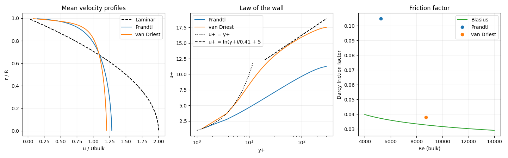

# Experiment 10: Turbulent Pipe Flow with Algebraic RANS Closures

**Author:** Ayush Singh  
**Date:** November 4, 2026

## Aim
Compute the mean velocity profile of fully developed turbulent pipe flow using the finite-volume method with zero-equation (algebraic) eddy-viscosity closures, Prandtl mixing length and van Driest damped mixing length, and compare them with the law of the wall and the Blasius friction factor.

## Assumptions & Limitations
* **Fully Developed, Steady, Axisymmetric:** Only the time-averaged axial velocity $u(r)$ exists; no variation along $x$ or $\theta$.
* **Boussinesq Hypothesis:** The Reynolds stress is modelled as $-\langle u'v'\rangle=\nu_t\,du/dr$.
* **Algebraic Closure:** $\nu_t$ is set by a local mixing length; no transport equations (no $k$–$\varepsilon$ etc.).
* **Fixed Pressure Gradient:** The gradient is prescribed through the friction velocity $u_\tau$, so the bulk velocity $U_b$ (and $Re$) is an *output*.
* **Smooth Wall, Constant Properties:** Incompressible, constant $\nu$.
* **Validation Caveat:** Agreement with Blasius alone does not validate a turbulence model, because the pressure gradient is imposed; the velocity profile (law of the wall) must be checked as well.

## Governing Equations & Simplification
Starting from the Reynolds-averaged axial momentum equation, all terms vanish except the pressure gradient and the radial shear stress:

$$0=G+\frac{1}{r}\frac{d}{dr}\left[r(\nu+\nu_t)\frac{du}{dr}\right],\qquad G=-\frac{1}{\rho}\frac{dp}{dx}=\frac{2u_\tau^2}{R}$$

**Wall balance:** a force balance on the whole pipe gives $\tau_w=\rho u_\tau^2=-\frac{dp}{dx}\frac{R}{2}$, hence $G=2u_\tau^2/R$.

**Exact shear stress.** Integrating once with $du/dr=0$ on the axis,

$$(\nu+\nu_t)\frac{du}{dr}=-\frac{G\,r}{2}$$

so the total stress is linear in $r$, zero at the axis and equals $\rho u_\tau^2$ at the wall. The closure decides only how this stress is split between its viscous ($\nu\,du/dr$) and turbulent ($\nu_t\,du/dr$) parts.

**Closures.** With wall distance $y=R-r$ and $\nu_t=l_m^2|du/dr|$:

$$\text{Prandtl:}\quad l_m=\kappa y$$

$$\text{van Driest:}\quad l_m=\kappa y\left(1-e^{-y^+/A^+}\right),\qquad y^+=\frac{yu_\tau}{\nu}$$

with $\kappa=0.41$ and $A^+=26$. The exponential factor damps the eddies in the viscous layer, where molecular viscosity dominates.

**Algebraic solution of the local shear.** Writing $s=|du/dr|$, the stress balance becomes the quadratic $l_m^2s^2+\nu s-Gr/2=0$, i.e.

$$s=\frac{-\nu+\sqrt{\nu^2+2l_m^2Gr}}{2l_m^2}$$

Two limits recover the classical wall laws:
* **Viscous sublayer** ($y^+\ll1$, $\nu_t\to0$): $u^+=y^+$.
* **Log layer** ($\nu\ll\nu_t$, $l_m=\kappa y$, $\tau\approx\rho u_\tau^2$): $du/dy=u_\tau/(\kappa y)$, giving $u^+=\frac{1}{\kappa}\ln y^++B$ with $B\approx5.0$.

**Laminar limit ($\nu_t=0$):** $u=\dfrac{G}{4\nu}(R^2-r^2)$ (Hagen–Poiseuille), used as the verification case.

**Bulk quantities:**

$$U_b=\frac{1}{\pi R^2}\int_0^{R}u\,2\pi r\,dr,\quad Re_D=\frac{2RU_b}{\nu},\quad f_D=8\left(\frac{u_\tau}{U_b}\right)^2,\quad f_{Blasius}=0.3164\,Re_D^{-1/4}$$

## Discretization & Algorithm
### Finite-Volume Formulation
The pipe is divided into $N$ concentric rings of width $h=R/N$ with velocity at ring centres $r_i=(i+\tfrac12)h$ and faces at $r_f=ih$ (face $0$ = axis, face $N$ = wall). Integrating the governing equation over ring $i$ (volume $V_i=\pi(r_{f,i+1}^2-r_{f,i}^2)$ per unit length, face area $A_f=2\pi r_f$):

$$A_e\nu_{eff,e}\left.\frac{du}{dr}\right|_e-A_w\nu_{eff,w}\left.\frac{du}{dr}\right|_w+GV_i=0$$

Using central differences $du/dr|_f=(u_{i+1}-u_i)/h$ and the conductance $D_f=A_f\nu_{eff,f}/h$ gives a tridiagonal system:

$$(D_w+D_e)u_i-D_wu_{i-1}-D_eu_{i+1}=GV_i$$

**Boundary treatment:**
* **Axis face:** $A=0$ (symmetry, no flux), so $D_w=0$ for the first ring.
* **Wall face:** the wall is only $h/2$ from the last node, $u_{wall}=0$, $\nu_t=0$, so $D_{wall}=A_R\nu/(h/2)$ and $du/dr|_{wall}=-u_N/(h/2)$.

The matrix is assembled as a small dense array and solved directly (a TDMA would be used for large $N$).

### Nonlinearity: Picard Iteration
Because $\nu_t$ depends on $du/dr$, the system is nonlinear. The effective viscosity is frozen from the latest $u$, the linear system is solved, and the result is under-relaxed:

$$u^{k+1}=\omega\,u_{new}+(1-\omega)\,u^k,\qquad\omega=0.25$$

until $\max|u_{new}-u^k|<10^{-10}$. The first pass (with $u=0\Rightarrow\nu_t=0$) automatically yields the laminar solution as the starting guess.

## Methodology and Boundary Conditions
**Table 1: Parameters for the turbulent pipe simulation.**

| Parameter | Value | Parameter | Value |
| :--- | :--- | :--- | :--- |
| Pipe radius $R$ | $0.025 \text{ m}$ | Kinematic viscosity $\nu$ | $1.5\times10^{-5} \text{ m}^2/\text{s}$ |
| Friction velocity $u_\tau$ | $0.18 \text{ m/s}$ | $Re_\tau=u_\tau R/\nu$ | $300$ |
| Driving term $G=2u_\tau^2/R$ | $2.592 \text{ m/s}^2$ | Rings $N$ | $120$ |
| von Kármán constant $\kappa$ | $0.41$ | van Driest constant $A^+$ | $26$ |
| Relaxation $\omega$ | $0.25$ | Picard tolerance | $10^{-10}$ |

* **Axis ($r=0$):** symmetry, $du/dr=0$.
* **Wall ($r=R$):** no slip, $u=0$.

Three models are run: Laminar ($\nu_t=0$, verification), Prandtl, and van Driest.

## Results & Discussions
Figure 1 shows (left) the normalized mean-velocity profiles, (centre) the profiles in wall units compared with $u^+=y^+$ and $u^+=\ln y^+/0.41+5$, and (right) the computed friction factors against the Blasius correlation.

  
*Figure 1: Left: mean velocity profiles; centre: law of the wall; right: Darcy friction factor versus Blasius.*

The laminar case reproduces the parabolic Poiseuille profile, verifying the discretization. Both turbulent closures give much flatter profiles than the laminar one, since $\nu_t$ promotes momentum mixing across the core. In both the law-of-the-wall plot and the friction-factor comparison, the **van Driest** model agrees better than plain Prandtl. The reason is that Prandtl's $l_m=\kappa y$ keeps eddy viscosity active arbitrarily close to the wall and ignores viscous damping, so the viscous sublayer and buffer region are not represented properly. The van Driest damping function restores the linear sublayer and the transition into the log law.

## Conclusion
A finite-volume solution of the radial momentum balance with Boussinesq eddy viscosity was implemented, with the nonlinearity handled by under-relaxed Picard iteration. The Poiseuille check verified the discretization, and the van Driest closure was found to reproduce the near-wall law and the friction factor better than the Prandtl mixing length. Since the pressure gradient is imposed, the match with Blasius is a consistency check rather than a full validation; two-equation models or DNS data would be needed for further assessment.