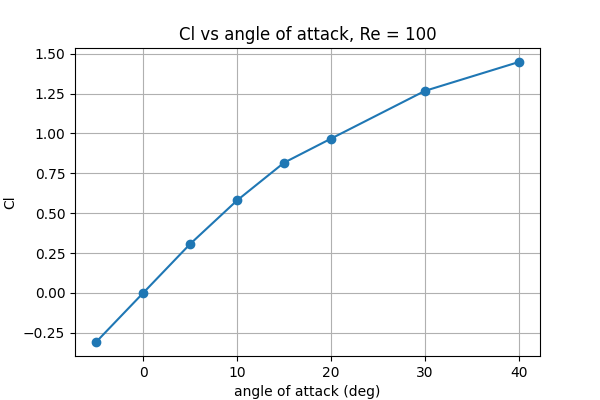
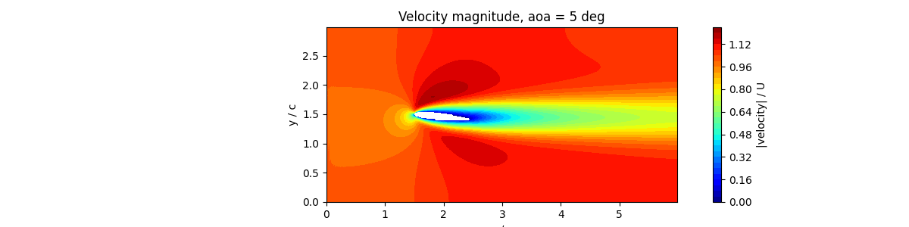
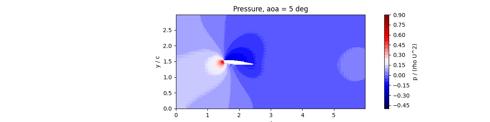
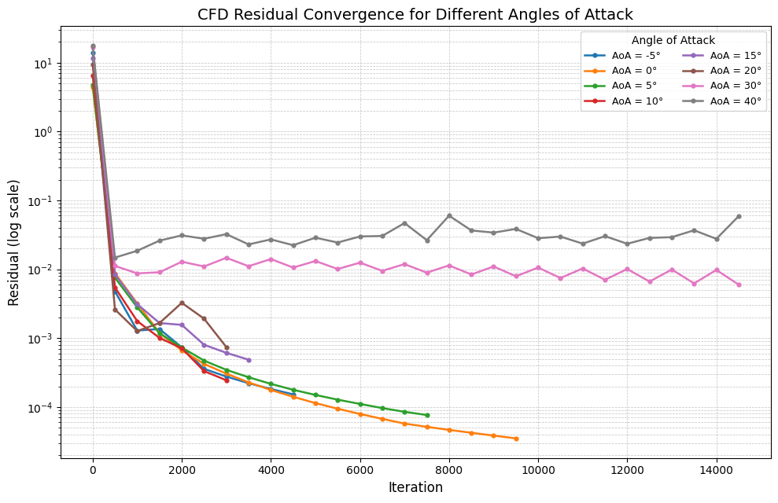

# Experiment 1: Airfoil with Immersed Boundary Method

**Author:** Ayush Singh  
**Date:** October 11, 2026

## Aim
Study the influence of angle of attack on the velocity, pressure, wake, and qualitative force trends around a NACA 0012 airfoil.

## Assumptions
The following key assumptions and limitations apply to this supplied teaching model:
* **Incompressible Flow:** The fluid is assumed to be fully incompressible with a constant density.
* **Immersed Boundary:** The volume penalization method does not use a body-fitted mesh. Consequently, a penalty force term is added to the momentum equation as source term for force calculation and approximating surface as solid interface. 
* **2D Domain:** Spanwise flow variations are neglected.

## Methodology and Domain
The simulation utilizes a Cartesian grid of size $L_x = 6c$ and $L_y = 3c$, where $c$ is the airfoil chord length. The NACA 0012 airfoil is placed with its leading edge at $x = 1.5c$ and centered vertically at $y = 1.5c$. 

Rather than conforming the mesh to the airfoil, an Immersed Boundary Method (volume penalization) is employed. A masking function $\alpha(x,y)$ is generated dynamically for each angle of attack, taking a value of $1$ inside the airfoil geometry and $0$ in the fluid. Using this mask, the forcing function is applied only to the airfoil region.

## Governing Equation & Discretization
The non-dimensional Navier-Stokes equations, augmented with a volume penalty term to enforce zero velocity inside the solid domain, are defined as:

$$ \frac{\partial \mathbf{u}}{\partial t} + (\mathbf{u} \cdot \nabla)\mathbf{u} = -\nabla p + \frac{1}{Re} \nabla^2 \mathbf{u} - \frac{\alpha}{\eta} \mathbf{u} $$

where $\eta \ll 1$ is the non-dimensional penalty parameter. 

The equations are discretized using a fractional-step projection method on a collocated grid. The predictor step uses explicit central differencing for the convective and diffusive terms, while the penalty term is handled implicitly for stability. For the $x$-velocity component $u$, the discretized predictor step is:

$$ u^* = \frac{u^n + \Delta t \left[ -u^n \frac{\partial u^n}{\partial x} - v^n \frac{\partial u^n}{\partial y} + \frac{1}{Re} \left( \frac{\partial^2 u^n}{\partial x^2} + \frac{\partial^2 u^n}{\partial y^2} \right) - \frac{\partial p^n}{\partial x} \right]}{1 + \Delta t \frac{\alpha}{\eta}} $$

A similar equation is solved for the $y$-velocity component $v^*$. 

To satisfy continuity, a pressure correction $p'$ is obtained by solving the exact Poisson equation using an eigendecomposition (spectral) solver:

$$ \nabla^2 p' = \frac{\nabla \cdot \mathbf{u}^*}{\Delta t} $$

The velocity and pressure fields are then updated:

$$ \mathbf{u}^{n+1} = \mathbf{u}^* - \Delta t \nabla p' $$
$$ p^{n+1} = p^n + p' $$

## Methodology and Boundary Conditions
The simulation marches in time until the variation in the lift coefficient ($C_l$) over 500 steps falls below $10^{-4}$. The physical and numerical parameters are documented in Table 1.

**Table 1: Complete parameter set and grid definition.**

| Parameter | Value | Parameter | Value |
| :--- | :--- | :--- | :--- |
| Grid ($N_x \times N_y$) | $400 \times 200$ | Domain ($L_x \times L_y$) | $6c \times 3c$ |
| Reynolds No. ($Re$) | $100$ | Inlet Velocity ($U$) | $1.0$ |
| Thickness Ratio ($tk$) | $0.12$ | Time Step C.F.L. ($Co$) | $0.2$ |
| Penalty Param ($\eta$) | $0.1 \Delta t$ | Convergence Tol. | $1.0\times 10^{-4}$ |

The following boundary conditions are applied to the rectangular domain:
* **Inlet (Left):** Uniform inflow ($u = 1, v = 0$) and zero-gradient pressure ($\partial p / \partial x = 0$).
* **Outlet (Right):** Zero-gradient velocity ($\partial u / \partial x = 0, \partial v / \partial x = 0$) and fixed reference pressure ($p = 0$).
* **Top & Bottom:** Symmetry condition ($\partial u / \partial y = 0, v = 0, \partial p / \partial y = 0$).

## Results & Discussions

**Lift and Drag:**
Table 2 provides the comparison of final continuity residuals, lift coefficients, and drag coefficients. As expected for a symmetric airfoil, $C_l$ at $0^\circ$ is near zero (-0.0008). As the angle of attack increases to $10^\circ$, $C_l$ increases linearly. 

**Table 2: Quantitative comparison of forces and residuals at $Re = 100$.**

| Angle of Attack ($\alpha$) | Steps | $C_l$ | $C_d$ | Final Residual |
| :--- | :--- | :--- | :--- | :--- |
| -5$^\circ$ | 4768 | -0.3080 | 0.4651 | 1.40e-04 |
| 0$^\circ$ | 9602 | -0.0008 | 0.4545 | 3.45e-05 |
| 5$^\circ$ | 7858 | 0.3064 | 0.4650 | 7.16e-05 |
| 10$^\circ$ | 3420 | 0.5800 | 0.5062 | 1.96e-04 |

Figure 1 visualizes this proportional relationship between the lift coefficient and the angle of attack prior to the onset of deep stall.

  
*Figure 1: Lift coefficient ($C_l$) versus Angle of Attack.*

**Wake and Flow Field Behavior:**
Figure 2 shows the velocity magnitude field. At $5^\circ$ angle of attack, the wake is attached and symmetrical. At higher angles of attack, a clear physical flow separation begins to manifest, heavily expanding the wake thickness on the suction side. The volume penalization smoothly transitions the velocity from the free stream to strictly zero inside the solid boundary.

  
*Figure 2: Velocity magnitude field highlighting wake behavior and flow separation.*

**Pressure Distribution:**
Figure 3 outlines the pressure field. At positive angles of attack, a distinct high-pressure stagnation region forms on the lower (pressure) side, while a low-pressure region develops on the upper (suction) side. This pressure differential is the primary physical mechanism driving the aerodynamic lift.

  
*Figure 3: Pressure field showing distinct pressure-side and suction-side behavior.*

**Convergence and Residuals:** 
Figure 4 illustrates the error history of the continuity residual. For lower angles of attack ($\alpha = 0^\circ, 5^\circ$), the residuals decrease steadily, indicating that the fractional step method effectively satisfies mass conservation and reaches a stable steady-state limit. However, at higher angles of attack ($\alpha \ge 15^\circ$), the flow enters a stall condition. The severe flow separation and resulting transient vortex shedding prevent the solution from reaching a true steady state, which is reflected in the residual plots as oscillating or stagnating convergence histories that fail to drop below the tolerance threshold.

  
*Figure 4: Residual history demonstrating steady-state convergence at low angles and stagnation during stall.*

## Conclusion
The aerodynamics of a NACA 0012 airfoil at $Re=100$ were effectively analyzed using an Immersed Boundary Method. The volume penalization approach successfully simulated the solid interface without requiring a complex mesh. The results confirmed standard physical behaviors, including proportional lift scaling and distinct pressure/suction side formation. Furthermore, the residual tracking effectively highlighted the physical transition from steady-state attached flow to unsteady flow separation and stall at higher angles of attack.