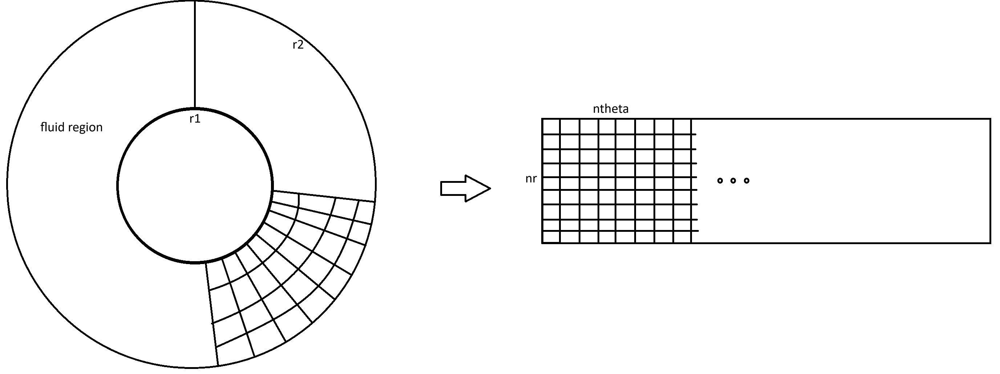
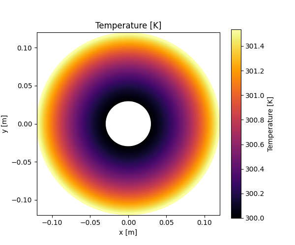
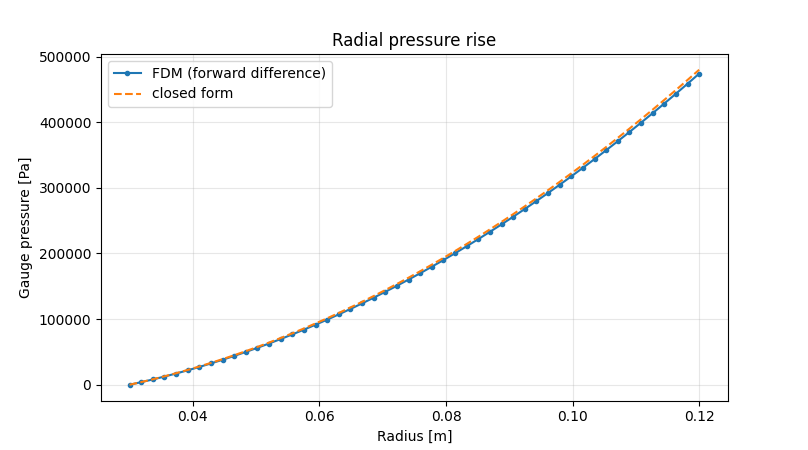
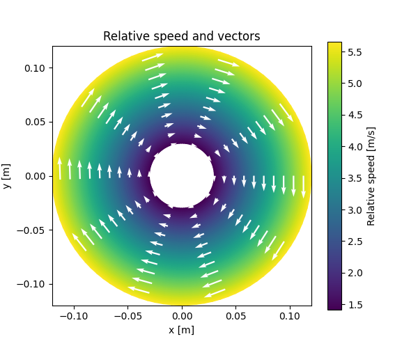
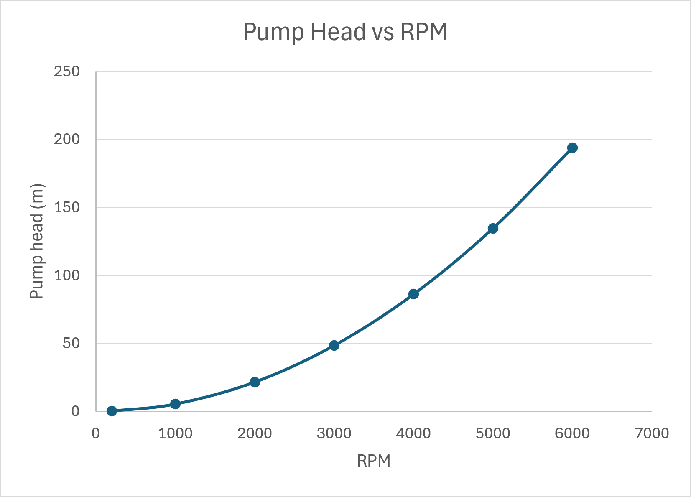

# Experiment 3: Centrifugal Pump

**Author:** Ayush Singh  
**Date:** October 11, 2026

## Aim
Study pressure rise, pump head, velocity components, and temperature rise in a simplified rotating annular passage. 

## Assumptions
The following key assumptions and simplifications are considered for this model:
* **Steady-State:** The fluid domain and heat transfer are assumed to be in a steady-state condition.
* **Predefined Velocity Field:** A fully developed, predefined velocity field is assumed rather than solving the full Navier-Stokes equations.
* **Uniform Properties:** Fluid properties such as thermal conductivity ($k$), density ($\rho$), and specific heat capacity ($C_p$) are uniform and constant.
* **Heat Generation:** Heat generation due to mechanical losses is modeled as an internal source term: $\tilde{S}_T = \frac{f_{loss} (\Omega r)^2 v}{b \cdot c_p}$.
* **Heat Transfer:** Heat transfer from the surroundings is modeled using a convective boundary interaction: $q'' = h_{wall}(T_w - T)$.
* **Simplified Domain:** The geometry is simplified to a 2D rotating annular passage without modeling complex geometries like individual impeller blades.
* **Discretization:** The partial differential equations are discretized using the Finite Difference Method (FDM).
* **Explicit Approach:** An explicit Jacobi iteration scheme is utilized to march towards the steady-state thermal solution.

## Methodology and Domain
The centrifugal pump is simplified as a radial setup with a circular domain. The domain has two walls, an internal side ($r_1$) and an external side ($r_2$), with the fluid in between. 

As shown in Figure 1, the physical circular domain is computationally treated as a rectangular Cartesian grid. The equations are solved in this rectangular computational grid using polar coordinate system equations. To plot the results back to the physical circular domain, a Jacobian transformation is applied using $x = r\cos\theta$ and $y = r\sin\theta$ to visualize the fields accurately.

  
*Figure 1: Mapping of the physical circular domain into a rectangular computational grid.*

The fluid velocity is predefined where $u$ is the velocity component along $\theta$, and $v$ is along $r$. $w$ represents the relative velocity with respect to the rotating blade (not an outside observer). The prescribed velocity components are defined as:

$$u = \text{swirl} \cdot \Omega \cdot R$$
$$w = u - \Omega \cdot R$$
$$v = \frac{v_1 \cdot r_1}{R}$$

where $v_1$ is the inlet radial speed. The gauge pressure is calculated from the prescribed velocity using forward Euler numerical discretization based on the equation:

$$\frac{dp}{dr} = \rho \frac{u^2}{r} - \frac{12 \mu v}{b^2}$$

## Governing Equation & Discretization
The steady-state energy equation for the rotating frame is given by:

$$\rho c_p\left(u_r\frac{\partial T}{\partial r} +\frac{w_\theta}{r}\frac{\partial T}{\partial\theta}\right) = k\left[\frac{1}{r}\frac{\partial}{\partial r} \left(r\frac{\partial T}{\partial r}\right) +\frac{1}{r^2}\frac{\partial^2T}{\partial\theta^2}\right] +\rho c_p\beta(T_w-T)+S_T$$

Dividing by $\rho c_p$ and substituting $\alpha = \frac{k}{\rho c_p}$, the expanded PDE becomes:

$$v \frac{\partial T}{\partial r} + \frac{w}{r}\frac{\partial T}{\partial\theta} = \alpha \left( \frac{\partial^2 T}{\partial r^2} + \frac{1}{r}\frac{\partial T}{\partial r} + \frac{1}{r^2}\frac{\partial^2T}{\partial\theta^2} \right) + \beta(T_w-T) + \tilde{S}_T$$

Using Finite Difference Method (FDM) Central Difference schemes (denoting $T_{i,j}$ as $T_P$, $T_{i+1,j}$ as $T_E$, $T_{i-1,j}$ as $T_W$, $T_{i,j+1}$ as $T_N$, $T_{i,j-1}$ as $T_S$):

$$\frac{\partial T}{\partial r} \approx \frac{T_E - T_W}{2\Delta r}$$
$$\frac{\partial^2 T}{\partial r^2} \approx \frac{T_E - 2T_P + T_W}{\Delta r^2}$$
$$\frac{\partial^2 T}{\partial \theta^2} \approx \frac{T_N - 2T_P + T_S}{\Delta \theta^2}$$

Rearranging the discretized equation to solve for $T_P$ yields the explicit Jacobi iteration update step:

$$T_P = \frac{ \frac{v \cdot T_W}{\Delta r} - \frac{w}{r} \frac{T_N}{\Delta \theta} + \alpha \left[ \frac{T_E + T_W}{\Delta r^2} + \frac{T_E - T_W}{2 r \Delta r} + \frac{T_N + T_S}{r^2 \Delta \theta^2} \right] + \beta T_w + \tilde{S}_T }{ \frac{v}{\Delta r} - \frac{w}{r \Delta \theta} + \frac{2\alpha}{\Delta r^2} + \frac{2\alpha}{r^2 \Delta \theta^2} + \beta }$$

## Methodology and Boundary Conditions
The setup utilizes the Jacobi iteration method to reach a steady-state solution. The linear-system iteration continues until the maximum absolute difference between consecutive temperature fields falls below the set residual tolerance. 

**Table 1: Baseline simulation input properties using SI units.**

| Parameter | Value | Parameter | Value |
| :--- | :--- | :--- | :--- |
| Density ($\rho$) | $997 \text{ kg/m}^3$ | Grid Size ($nr \times ntheta$) | $50 \times 100$ |
| Dyn. Viscosity ($\mu$) | $0.001 \text{ Pa}\cdot\text{s}$ | Inner Radius ($r_1$) | $0.03 \text{ m}$ |
| Spec. Heat ($C_p$) | $4180 \text{ J/kg}\cdot\text{K}$ | Outer Radius ($r_2$) | $0.12 \text{ m}$ |
| Therm. Cond. ($k$) | $0.6 \text{ W/m}\cdot\text{K}$ | Passage Depth ($b$) | $0.010 \text{ m}$ |
| Wheel Speed | $3000 \text{ RPM}$ | Inlet Radial Speed ($v_1$) | $0.025 \text{ m/s}$ |
| Swirl Fraction | $0.85$ | Loss Fraction ($f_{loss}$) | $0.04$ |
| Wall Temp ($T_{wall}$) | $330 \text{ K}$ | Inlet Temp ($T_{in}$) | $300 \text{ K}$ |
| Heat Trans. Coeff ($h_{wall}$) | $120 \text{ W/m}^2\text{K}$ | | |

The following boundary conditions are applied:
* **Inlet ($r = r_1$):** Dirichlet boundary condition where $T = 300$ K.
* **Outlet ($r = r_2$):** Zero-gradient (Neumann) boundary condition where $\frac{\partial T}{\partial r} = 0$.
* **Azimuthal direction ($\theta$):** Periodic boundary conditions ensuring $T(r, 0) = T(r, 2\pi)$.

## Results & Discussions
The FDM solver successfully maps the thermal and flow behavior of the idealized rotating passage. 

**Temperature Field Analysis:** Figure 2 displays the scalar temperature field across the computational domain. As the fluid moves radially outward, the temperature gradually increases. This is due to the heat transfer from the walls and the internal heat generation modeled via the mechanical loss term ($S_T$).

  
*Figure 2: Temperature field distribution in the pump.*

**Pressure Rise Verification:** Figure 3 verifies the numerical forward difference scheme against the exact analytical closed-form solution for radial gauge pressure. The numerical profile perfectly tracks the analytical curve, demonstrating that the chosen radial step size ($\Delta r$) is sufficiently small to capture the pressure gradient accurately without accumulating severe truncation errors.

  
*Figure 3: Verification check: Radial gauge pressure rise comparison between numerical and closed-form solutions.*

**Velocity Distribution:** Figure 4 visualizes the relative speed vectors of the fluid. The vectors illustrate the rotational swirl relative to the moving domain while obeying the radial continuity constraints, showing higher relative velocities towards the outer perimeter as dictated by the predefined kinematics.

  
*Figure 4: Labelled field of relative fluid speed and directional vectors.*

**RPM Scaling Study:** Further analysis of the system dynamics reveals a non-linear relationship between the pump head and the rotational speed. As demonstrated in Figure 5, the pump head increases parabolically with RPM. This occurs because the dominant term in the pressure gradient equation scales directly with the square of the rotational velocity ($\Omega^2$).

  
*Figure 5: Parameter study: Pump Head (m) plotted against rotational speed (RPM).*

**Grid Independence Verification:** Grid independence was verified by systematically refining the grid size, as documented in Table 2. At higher resolutions, the outlet temperature stabilizes at 301.5 $^\circ$C and the pump head approaches an asymptotic value of 48.88 m. The pressure error consistently drops with refinement, and the final linear-system residuals remain tightly constrained below $1.0\times 10^{-7}$, confirming the strict numerical stability and consistency of the FDM approach.

**Table 2: Grid refinement verification check.**

| Grid ($nr \times n\theta$) | Pump Head (m) | Outlet Temp ($^\circ$C) | Pressure Error | Final Residual |
| :--- | :--- | :--- | :--- | :--- |
| (40, 80) | 48.46 | 301.48 | 1.22% | 9.98E-08 |
| (80, 160) | 48.69 | 301.50 | 0.76% | 9.99E-08 |
| (160, 320) | 48.88 | 301.50 | 0.38% | 9.99E-08 |

## Conclusion
The simplified centrifugal rotating annular passage was successfully modeled. Transforming the polar governing equations into a rectangular computational grid allowed for an efficient steady-state FDM solution utilizing Jacobi iterations. Grid refinement and parameter scaling successfully validated the expected physical behaviors and verified the stability of the explicit numerical scheme.