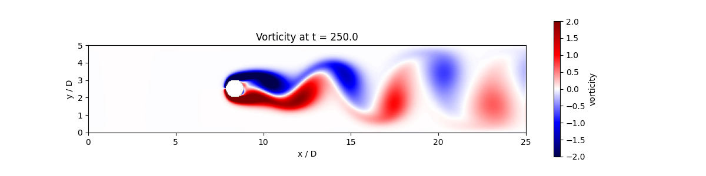
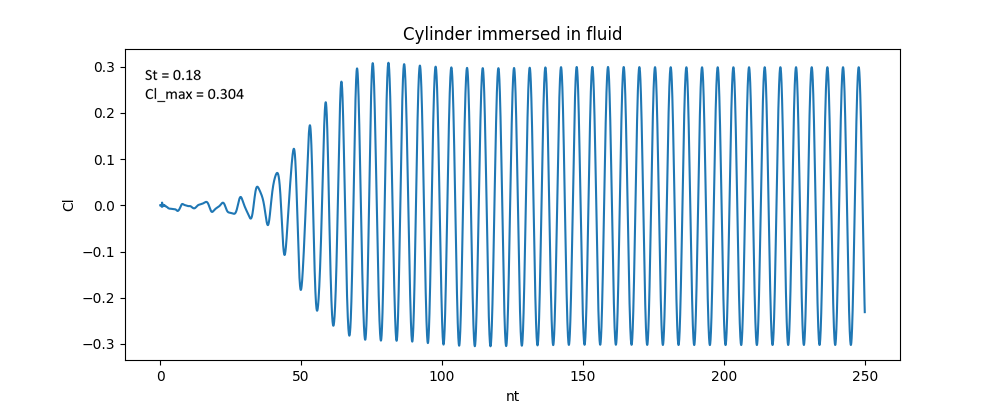

# Experiment 4: Von Karman Vortex Street

**Author:** Ayush Singh  
**Date:** October 11, 2026

## Aim
Resolve the alternating vortex shedding behind a circular cylinder at a Reynolds number of $Re = 100$. Estimate the Strouhal number, mean drag, lift amplitude, and density deviation, while visualizing the vorticity sequence over the shedding cycle.

## Assumptions & Limitations
The following limitations apply to the supplied teaching model:
* **2D Domain:** The simulation is two-dimensional
* **Immersed Boundary Smearing:** A smooth mask $\alpha(x,y)$ is used to treat the fluid-solid interface, transitioning from 1 inside the solid to 0 outside. This mask is used to apply virtual force term in the momentum equation.
* **Fluid properties:** Incompressible fluid with uniform properties

## Methodology and Domain
The computational domain is a rectangular channel with a length of $25D$ (where $D=1.0$ is the cylinder diameter) and a height of $5D$. The circular cylinder is immersed in the fluid and centered at $x = 8.33D$ ($L_x/3$) and $y = 2.5D$ ($L_y/2$). 

## Governing Equations & Boundary Conditions
The simulation solves the incompressible Navier-Stokes equations for momentum and continuity, augmented with a penalty term to enforce zero velocity inside the cylinder:

$$ \frac{\partial \mathbf{u}}{\partial t} + (\mathbf{u} \cdot \nabla)\mathbf{u} = -\nabla p + \frac{1}{Re} \nabla^2 \mathbf{u} - \frac{\alpha}{\eta}\mathbf{u} $$

The boundary conditions governing the domain are explicitly enforced as:
* **Inlet (Left):** Uniform fixed velocity ($u=1, v=0$) and a zero-gradient pressure condition.
* **Outlet (Right):** Zero-gradient velocity to allow vortices to exit, and fixed reference pressure ($p=0$).
* **Top & Bottom:** Symmetry boundaries ($\frac{\partial u}{\partial x}=0, v=0$) with a zero-gradient pressure condition.

**Table 1: Complete parameter set and grid definition.**

| Parameter | Value | Parameter | Value |
| :--- | :--- | :--- | :--- |
| Reynolds No. ($Re$) | $100$ | Domain Length | $25D$ |
| Cylinder Diameter ($D$) | $1.0$ | Domain Height | $5D$ |
| Grid Resolution ($N_x \times N_y$) | $500 \times 100$ | Cylinder Position ($x, y$) | $8.33D, 2.5D$ |
| Time Step ($\Delta t$) | $0.005$ | Simulation Time ($t$) | $250.0$ |

## Results & Discussions

**Vorticity and Shedding Cycle (Physical vs. Numerical):**
Figure 1 displays a snapshot of the vorticity field ($w = \partial v/\partial x - \partial u/\partial y$) at $t = 250.0$. The physical interpretation of this field confirms the classic Von Karman vortex street: alternating vortices of positive (red) and negative (blue) vorticity shed from the upper and lower surfaces of the cylinder. Numerically, the strength of these vortices visibly decays as they approach the outlet near $x/D = 25$, which is a combination of physical viscous dissipation and numerical diffusion inherent to the grid's upwind spatial discretization scheme.

  
*Figure 1: Vorticity field at $t=250.0$ showing the alternating shedding cycle.*

**Transient Development and Lift History:**
Figure 2 serves as the primary history of the system's dynamic state. As the flow field information travels across the domain, the wake region starts to develop and stably separate from the cylinder. The oscillating flow separations causes the lift coefficient ($C_l$) to oscillate with growing amplitude. After the start-up transient is discarded, the system reaches a stable, periodic cycle. 

  
*Figure 2: Lift coefficient history demonstrating the transition from steady flow to periodic shedding.*

Table 2 provides the quantitative deliverables for the $Re = 100$ lab preset. The maximum lift amplitude converges to $C_{l, max} = 0.304$. By running a Fast Fourier Transform (FFT) on the latter half of the lift oscillation data, the dimensionless shedding frequency yields an estimated Strouhal number of $St = 0.18$.

**Table 2: Quantitative summary of the vortex shedding behavior.**

| Metric | Value at $Re = 100$ |
| :--- | :--- |
| Estimated Strouhal Number ($St$) | $0.18$ |
| Lift Amplitude ($C_{l, max}$) | $0.304$ |

## Conclusion
The immersed boundary method successfully resolved the Von Karman vortex street behind a circular cylinder at $Re = 100$. The simulation effectively captured the transition from a symmetric steady state to a periodic limit cycle, yielding a maximum lift amplitude of $C_{l, max} = 0.304$ and an estimated Strouhal number of $St = 0.18$.